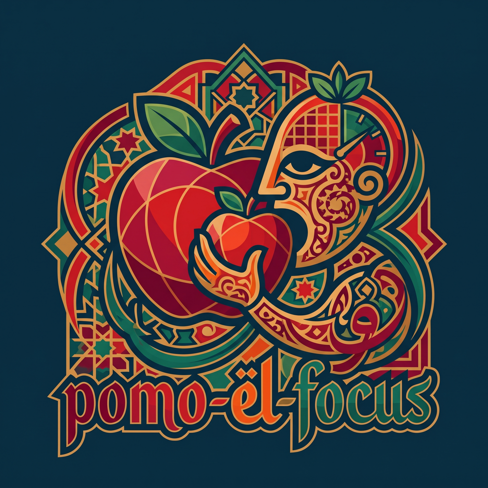

<div align="center">


<p align="center">
  
</p>

<h3><b>Pomodoro</b> — a local-first Windows 11 focus timer</h3>

<a href="#-what-is-pomodoro"></a>
<a href="#-features"></a>
<a href="#-reports"></a>
<a href="#-tech-stack"></a>
<a href="#-build-and-run"></a>

<br />


</div>

---

## 🍅 What is Pomodoro?

**Pomodoro** is a single-file AutoHotkey v2 desktop application for Windows 11, modelled on the rhythm of [pomofocus.io](https://pomofocus.io). It gives you a focused 25-minute countdown, a real task list, lightweight reports, and a tray-first workflow — without a browser, account, cloud service, or background telemetry.

It is built to stay out of the way. The countdown is derived from monotonic tick deltas rather than counting timer messages, so pauses, lag, and system sleep do not make it drift. Everything is stored in a local folder, written through a temporary-file swap, and designed to survive a crash without corrupting your task history.

> 🛡️ **Privacy is part of the design.** The app makes no network requests. Your tasks, projects, pomodoro history, settings, and window state never leave this PC.

---

## ✨ Features

| | Feature | What it does |
| :-: | :-- | :-- |
| ⏱️ | **Drift-free timer** | Uses `A_TickCount` deltas, with a UTC wall-clock correction for long sleep or suspend gaps. No 1-second incremental counting. |
| 🎨 | **Three focus phases** | Pomodoro (25 min), Short Break (5 min), and Long Break (15 min), each with its own full-window colour. Dark dimming applies while the timer runs. |
| ✅ | **Task workflow** | Add tasks with an estimate, note, and project; mark them done; make one active; and track completed/estimated pomodoros. |
| 🗂️ | **Projects and templates** | Create, rename, and delete projects. Save any task as a reusable template and add templates back with one click. |
| 📊 | **Local reports** | Summary, detail history, and project/task rankings, plus Week / Month / Year focus charts. Export all history to CSV. |
| 🔔 | **Native Windows behavior** | Tray menu, close-to-tray, taskbar flash, tray notification, always-on-top, single-instance guard, DPI-aware layout, and window-position memory. |
| 🎧 | **Configurable sound** | Built-in Windows alarm sounds plus custom `.wav` files, volume, repeat count, test button, and an optional low-CPU ticking sound with speed and volume. |
| ⚙️ | **Settings that stick** | Phase lengths, long-break interval, auto-start options, auto-switch task, 12/24-hour finish times, reminders, and dark mode. Changes apply instantly. |
| 🔒 | **Offline by default** | No accounts, no network calls, no external libraries or DLLs. A single `.ahk` or compiled `.exe` is all you need. |

---

## 🗂️ Tasks, Projects and Templates

<table align="center">
  <tr>
    <td align="center" width="33%">
      <h3>✅</h3>
      <b>Tasks</b><br />
      Checkbox completion<br />
      Active-task indicator<br />
      Notes and estimates<br />
      Right-click actions
    </td>
    <td align="center" width="33%">
      <h3>📁</h3>
      <b>Projects</b><br />
      Create and rename<br />
      Assign to tasks<br />
      Filter reports<br />
      Group rankings
    </td>
    <td align="center" width="33%">
      <h3>🧩</h3>
      <b>Templates</b><br />
      Save any task<br />
      Reuse in one click<br />
      No template limit<br />
      Delete when finished
    </td>
  </tr>
</table>

Clicking a task makes it active, so every completed focus session can be attributed automatically. The estimated finish line (**Pomos: 3/8 · Finish at 18:30 (2h 15m)**) accounts for the remaining pomodoros and the short/long breaks between them.

---

## 📊 Reports

Reports read only `history.csv` and stay inside the app:

| Tab | What you get |
| :-- | :-- |
| **Summary** | Total focused hours, days accessed, current day streak, and a colour-coded focus-time chart. |
| **Detail** | Every completed focus session with date, start time, task, project, and minutes. |
| **Ranking** | Aggregated sessions and hours, grouped by **project** or **task**. |

The chart has **Week / Month / Year** views, built from native `Progress` bars and `Text` labels instead of an external chart library. A project filter applies across all tabs, and **Export CSV** writes the complete history through a normal Save dialog.

---

## 🧰 Tech Stack

<div align="center">


</div>

| 🧱 Layer | ⚙️ What it uses |
| :-- | :-- |
| **Application** | One AutoHotkey v2 script, organised with classes and grouped state objects |
| **Timer engine** | Monotonic tick deltas plus a UTC wall-clock sleep/lag correction |
| **Interface** | Native Win32 controls: `Tab3`, `ListView`, `Progress`, buttons, text, menus |
| **Storage** | Local `settings.ini`, `tasks.tsv`, and `history.csv`; atomic temp-file replacements |
| **Audio** | Windows WAV playback with hand-written PCM volume scaling; no external codecs |
| **Packaging** | Optional standalone `.exe` via Ahk2Exe with `pomodoro.ico` |

No external libraries, DLLs, frameworks, or network components are used.

---

## 🚀 Build and Run

### Run from source

1. Install **AutoHotkey v2.0** or later.
2. Keep `pomodoro.ahk` and, optionally, `pomodoro.ico` in the same folder.
3. Double-click `pomodoro.ahk`.

The icon file is picked up automatically for the tray/window when it is beside the script.

### Compile a standalone .exe

1. Install **AutoHotkey v2.0** and **Ahk2Exe**.  
   If `C:\Program Files\AutoHotkey\Compiler\Ahk2Exe.exe` is missing, run `C:\Program Files\AutoHotkey\UX\install-ahk2exe.ahk` once, or install Ahk2Exe from the AutoHotkey website.
2. Start Ahk2Exe and use these settings:

| Field | Value |
| :-- | :-- |
| **Base File** | `C:\Program Files\AutoHotkey\v2\AutoHotkey64.exe` |
| **Source** | `pomodoro.ahk` |
| **Destination** | `Pomodoro.exe` |
| **Custom icon** | `pomodoro.ico` (or any multi-size `.ico`) |

3. Click **Compile**. The result is a standalone executable.

Command-line equivalent:

```bat
"C:\Program Files\AutoHotkey\Compiler\Ahk2Exe.exe" /in "C:\path\pomodoro.ahk" /out "C:\path\Pomodoro.exe" /base "C:\Program Files\AutoHotkey\v2\AutoHotkey64.exe" /icon "C:\path\pomodoro.ico"
```

> Use the **v2** base file. If you compile with a different embedded icon but leave `pomodoro.ico` beside the exe, the app prefers the external `.ico` for the tray icon.

### Self-test

The app includes a data-layer test that does not touch your real data folder:

```bat
"C:\Program Files\AutoHotkey\v2\AutoHotkey64.exe" /ErrorStdOut pomodoro.ahk --selftest
```

It prints `SELFTEST PASS` or a list of failures.

---

## 🔒 Privacy and Data

Everything lives in **`%AppData%\PomodoroApp`**:

| File / folder | Contents |
| :-- | :-- |
| `settings.ini` | Timer lengths, options, alarm/tick settings, last mode, active task, and window position |
| `tasks.tsv` | Tasks, projects, and templates, with tabs/newlines escaped |
| `history.csv` | Every completed focus session |
| `cache\` | Temporary volume-scaled WAV copies, cleared on next launch |

Writes are made to a temporary file and then moved over the original. Missing, unreadable, or corrupt files fall back to safe defaults without crashing the app. The timer itself resets on launch; tasks, projects, templates, and history persist.

---

## 🧭 Quick Usage

- Choose **Pomodoro**, **Short Break**, or **Long Break** at the top.
- Press **Start**; while running, **Skip** appears beside **Pause**.
- Click a task row to make it active, or tick its checkbox to finish it.
- Use **Edit** / **Delete** for the selected task, or right-click a row for more actions.
- The **Tasks** menu holds clear-finished, clear-all, and reset-count commands.
- **Templates** opens the reusable task menu.
- **Settings** and **Reports** are also available from the tray.
- Closing the window hides it to the tray by default. **Exit** lives only in the tray menu.

---

## ⚠️ Known Limitations

| Area | Limitation |
| :-- | :-- |
| **Task rows** | Edit/Delete are selected-row toolbar buttons and context-menu actions rather than embedded buttons inside every ListView row. |
| **Audio volume** | Volume scaling supports PCM and float WAVs. Compressed or unsupported WAV encodings play at their original volume. |
| **Layout** | Windows are fixed-size. Extremely high display scaling on a very low-resolution screen can clip the lower edge. |
| **Session state** | Mid-session timer state is intentionally not saved; the timer starts fresh on each launch. |
| **Reports** | Reports refresh on open, filter, or period change rather than continuously while visible. |
| **Notifications** | Windows Focus Assist and notification settings can suppress tray notifications. |
| **Clock changes** | A large manual system-clock jump can affect the current countdown's sleep correction. |

More implementation notes and test history are in [PROGRESS.md](PROGRESS.md).

---

## 📁 Project Structure

| File | Purpose |
| :-- | :-- |
| `pomodoro.ahk` | Complete single-file AutoHotkey v2 application |
| `pomodoro.ico` | Optional tray/exe icon with multiple embedded sizes |
| `logo.jpg` | Project logo used in this README |
| `README.md` | This document |
| `PROGRESS.md` | Completed milestones, decisions, and limitations |

---

<div align="center">

<sub>🍅 <b>Pomodoro</b> — AutoHotkey v2 · Windows 11 · Local only</sub>


</div>
